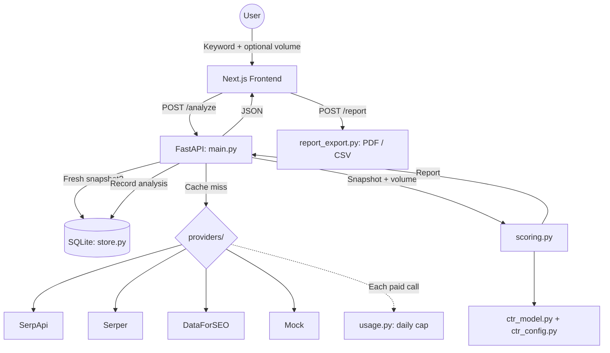

# System Architecture & Workflows

## 📐 System Overview

Startly Analyze is a Next.js frontend talking to a FastAPI backend. The backend fetches one Google results page per keyword from a pluggable data provider, stores it in SQLite, and scores it with a position-based click model.



## 🧠 Core Working Components

### 1. Data providers (`backend/providers/`)
Each provider returns the same **SERP snapshot** shape (see `providers/base.py`): the keyword, the provider name, optional volume, and a list of items typed with DataForSEO's vocabulary (`organic`, `ai_overview`, `paid`, `local_pack`, `images`, `people_also_ask`, …).

| Provider | File | Notes |
| :--- | :--- | :--- |
| SerpApi | `serpapi.py` | Detects AI Overviews, including lazy-loaded ones, in a single request |
| Serper | `serper.py` | Cheapest option; no AI Overview data |
| DataForSEO | `dataforseo.py` | SERP and search volume (paid) |
| Mock | `mock.py` | Deterministic fake data for development |

`SERP_PROVIDER` and `VOLUME_PROVIDER` in `.env` choose the providers. `usage.py` counts every paid call and returns HTTP 429 once `MAX_API_CALLS_PER_DAY` is reached.

### 2. Storage (`backend/db.py`, `backend/store.py`)
A local SQLite database at `backend/data/startly.db`:

| Table | Holds |
| :--- | :--- |
| `serp_snapshots` | Every fetched results page; the newest one within `CACHE_TTL_DAYS` is reused |
| `keyword_volume` | Volumes per keyword; user-entered ones never expire |
| `analyses` | One row per analysis, including the click range (`GET /history`) |
| `api_calls` | Paid calls, used for the daily cap |

`init_db()` adds new columns to older databases. In demo mode, an empty database is filled with the sample keywords from `demo_data/seed.json` (`demo_seed.py`), so a fresh container needs no database file.

### Own-key requests (`backend/stateless.py`)
Requests that carry an `X-SerpApi-Key` header are stateless: the search runs on the visitor's key, nothing is written to the database, and the server's daily cap doesn't apply. The response includes the normalized results page (`snapshot`), which the browser keeps (`frontend/lib/ownKey.ts`) and sends back to `POST /rescore` (re-score after a volume edit) or as `previous` on a re-check (compare with the last check). Incoming snapshots are size- and shape-limited.

### 3. Click model (`backend/ctr_model.py`, `backend/ctr_config.py`)
It turns the organic result count and the SERP features into click-through rates per position. It starts from a published baseline curve, applies sourced per-position multipliers for features that take clicks, and returns a low–high range: effects stacked vs strongest effect only. The full method and sources are in [METHODOLOGY.md](METHODOLOGY.md).

### 4. Scoring and report (`backend/scoring.py`)
It combines the snapshot, the volume and the click model into the API response:
*   **Capturable clicks** with their range, and clicks by position (`report.click_model`).
*   **Click loss %**: clicks removed compared with a plain page with the same organic count.
*   **Organic share**: organic items ÷ all page-one items. This describes the layout only.
*   **Verdict, recommendations and page one** (`insights.py`): what the top positions are worth, next steps from the page's features, and the ranking sites.
*   **Narrative sections** for the Details panel.

### 5. Frontend (`frontend/`)
*   `app/page.tsx`: the dashboard. Header form (keyword, volume, country), a keyword list on the left, and the selected keyword's detail on the right. It restores recent analyses on load.
*   `app/history/page.tsx`: searchable list of every saved analysis; clicking one reopens it (`/?open=<id>`).
*   Detail components, in page order: `VerdictHero` (verdict, clicks, position values, editable volume), `Recommendations`, `PageOne` (who ranks and each position's clicks), `WhatChanged` (re-check and comparison), `DetailsPanel` (full write-up, page items, sources).
*   `KeywordList` (sort, remove, export) and `BulkAnalysis` (cost preview, ranked results).
*   `CreditsStatus` (normal mode: data source switch, credit balances, daily cap) and `KeyDialog` (demo: add, check or forget your own SerpApi key).
*   `lib/analysis.ts`: shared row type, helpers, API calls and per-browser dashboard settings; `lib/ownKey.ts`: the visitor's key and own-key analyses, kept in the browser; `components/AnalyzeReport.tsx`: response types.
*   `proxy.ts`: sets the Content Security Policy with a fresh nonce on every page request.

### 6. Export engine
Built from the same data as the dashboard, so exports need no API calls.
*   `report_pdf.py`: the PDF report (ReportLab), with a cover, contents, summary, charts, a page per keyword and the method and sources. `pdf_fonts.py` registers the bundled Noto fonts (`fonts/`) so any language renders.
*   `report_export.py`: the keyword and rankings CSVs (UTF-8 for Excel, protected against formula injection).
*   `report_data.py`: helpers both share.

### 7. Public demo and security
*   `DEMO_MODE` (`config.py`): read-only. Only saved results pages are served, nothing is written, and no provider is called with the server's keys.
*   `ratelimit.py`: per-IP requests per minute, kept in memory. Behind a proxy it reads `X-Forwarded-For` from the right, so clients can't fake their address.
*   `security.py`: refuses visitor keys over plain HTTP (except localhost), adds HSTS on HTTPS and `Cache-Control: no-store`.
*   `credits.py`: balances of the server's SerpApi and Serper keys (normal mode only).

## 🔄 Sequence Workflows

### Keyword Analysis Flow
1.  **Submission**: The user enters a keyword, and optionally a monthly volume.
2.  **Snapshot**: The backend looks for a fresh snapshot in SQLite. On a miss it calls the configured provider (counted against the daily cap) and stores the result.
3.  **Volume**: The value used is, in order: the volume the user entered (saved for next time), a stored volume, the snapshot's own volume (mock data), or `VOLUME_PROVIDER`. Otherwise the volume is unknown.
4.  **Scoring**: `scoring.py` runs the click model and builds the report. The analysis is recorded in `analyses`.
5.  **Presentation**: The frontend renders the cards, the chart and the insights. With no volume, it shows click-through rates instead of click counts.

### Reporting Flow
1.  **Trigger**: The user picks a format and scope (all keywords or the selected one) in the **Export** menu.
2.  **Payload**: The frontend sends the analyses already on screen, so no API calls are needed.
3.  **Generation**: The backend returns the file, and the browser downloads it.

## 🐳 Containers
Each app has its own `Dockerfile`:
*   `backend/Dockerfile`: Python 3.13 slim, runs as a non-root user, listens on `$PORT` (default 8000).
*   `frontend/Dockerfile`: a two-stage build. The first stage installs everything and runs `next build` with `NEXT_PUBLIC_API_BASE_URL` passed as a build argument; the final image holds only Next's standalone server and static files.

`docker-compose.yml` in the project root runs both as the public demo. The backend keeps no state worth saving in demo mode (the seed refills it on start), so no volume is needed.

## 🧪 Tests
`backend/tests/` runs offline with a temporary database and no API keys. It covers providers, the click model (checked against AWR's measured effects), scoring, storage and migrations, the demo seed, security and rate limiting, exports, and the API endpoints.

```bash
cd backend && pytest
```

## 🛠️ Tech Stack
*   **Frontend**: Next.js 16 (React 19), TypeScript, Tailwind CSS, Framer Motion, Lucide.
*   **Backend**: FastAPI (Python 3.10+; the Docker image uses 3.13), Pydantic, Requests, SQLite, ReportLab.
*   **Deployment**: Docker, Docker Compose.
*   **Data**: SerpApi, Serper or DataForSEO (SERP); user input or DataForSEO (volume).
