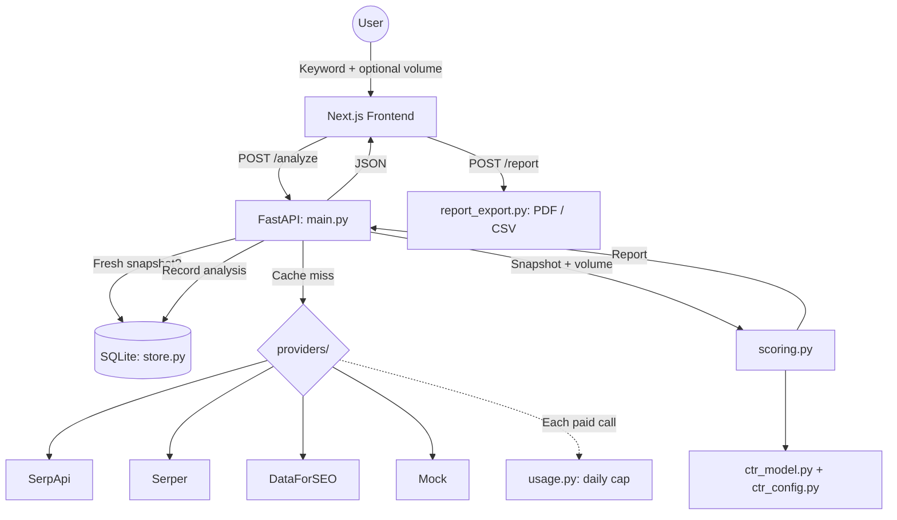

# System Architecture & Workflows

## 📐 System Overview

Startly Analyze is a Next.js frontend talking to a FastAPI backend. The backend fetches one Google results page per keyword from a pluggable data provider, stores it in SQLite, and scores it with a position-based click model.



## 🧠 Core Working Components

### 1. Data providers (`backend/providers/`)
Each provider returns the same **SERP snapshot** shape (see `providers/base.py`): the keyword, the provider name, optional volume, and a list of items typed with DataForSEO's vocabulary (`organic`, `ai_overview`, `paid`, `local_pack`, `images`, `people_also_ask`, …).

| Provider | File | Notes |
| :--- | :--- | :--- |
| SerpApi | `serpapi.py` | Detects AI Overviews, including lazy-loaded ones, in a single request |
| Serper | `serper.py` | Cheapest option; no AI Overview data |
| DataForSEO | `dataforseo.py` | SERP and search volume (paid) |
| Mock | `mock.py` | Deterministic fake data for development |

`SERP_PROVIDER` and `VOLUME_PROVIDER` in `.env` choose the providers. `usage.py` counts every paid call and returns HTTP 429 once `MAX_API_CALLS_PER_DAY` is reached.

### 2. Storage (`backend/db.py`, `backend/store.py`)
A local SQLite database at `backend/data/startly.db`:

| Table | Holds |
| :--- | :--- |
| `serp_snapshots` | Every fetched results page; the newest one within `CACHE_TTL_DAYS` is reused |
| `keyword_volume` | Volumes per keyword; user-entered ones never expire |
| `analyses` | One row per analysis, including the click range (`GET /history`) |
| `api_calls` | Paid calls, used for the daily cap |

`migrate_cache.py` imports the pre-SQLite JSON cache once on startup. `init_db()` adds new columns to older databases.

### Own-key requests (`backend/stateless.py`)
Requests that carry an `X-SerpApi-Key` header are stateless: the search runs on the visitor's key, nothing is written to the database, and the server's daily cap doesn't apply. The response includes the normalized results page (`snapshot`), which the browser keeps (`frontend/lib/ownKey.ts`) and sends back to `POST /rescore` (re-score after a volume edit) or as `previous` on a re-check (compare with the last check). Incoming snapshots are size- and shape-limited.

### 3. Click model (`backend/ctr_model.py`, `backend/ctr_config.py`)
It turns the organic result count and the SERP features into click-through rates per position. It starts from a published baseline curve, applies sourced per-position multipliers for features that take clicks, and returns a low–high range: effects stacked vs strongest effect only. The full method and sources are in [METHODOLOGY.md](METHODOLOGY.md).

### 4. Scoring and report (`backend/scoring.py`)
It combines the snapshot, the volume and the click model into the API response:
*   **Capturable clicks** with their range, and clicks by position (`report.click_model`).
*   **Click loss %**: clicks removed compared with a plain page with the same organic count.
*   **Organic share**: organic items ÷ all page-one items. This describes the layout only.
*   **Verdict, recommendations and page one** (`insights.py`): what the top positions are worth, next steps from the page's features, and the ranking sites.
*   **Narrative sections** for the Details panel.

### 5. Frontend (`frontend/`)
*   `app/page.tsx`: the dashboard. Header form (keyword, volume, country), a keyword list on the left, and the selected keyword's detail on the right. It restores recent analyses on load.
*   `app/history/page.tsx`: searchable list of every saved analysis; clicking one reopens it (`/?open=<id>`).
*   Detail components, in page order: `VerdictHero` (verdict, clicks, position values, editable volume), `Recommendations`, `PageOne` (who ranks and each position's clicks), `WhatChanged` (re-check and comparison), `DetailsPanel` (full write-up, page items, sources).
*   `KeywordList` (sort, remove, export) and `BulkAnalysis` (cost preview, ranked results).
*   `lib/analysis.ts`: shared row type, helpers, API calls and per-browser dashboard settings; `components/AnalyzeReport.tsx`: response types.

### 6. Export engine (`backend/report_export.py`)
ReportLab PDF and CSV exports built from the same data as the dashboard, including the click range, clicks by position, and the model's sources.

## 🔄 Sequence Workflows

### Keyword Analysis Flow
1.  **Submission**: The user enters a keyword, and optionally a monthly volume.
2.  **Snapshot**: The backend looks for a fresh snapshot in SQLite. On a miss it calls the configured provider (counted against the daily cap) and stores the result.
3.  **Volume**: The value used is, in order: the volume the user entered (saved for next time), a stored volume, the snapshot's own volume (mock data), or `VOLUME_PROVIDER`. Otherwise the volume is unknown.
4.  **Scoring**: `scoring.py` runs the click model and builds the report. The analysis is recorded in `analyses`.
5.  **Presentation**: The frontend renders the cards, the chart and the insights. With no volume, it shows click-through rates instead of click counts.

### Reporting Flow
1.  **Trigger**: The user clicks "Export PDF" or "CSV Dataset".
2.  **Payload**: The frontend sends the analyses already on screen, so no API calls are needed.
3.  **Generation**: The backend returns the file, and the browser downloads it.

## 🧪 Tests
`backend/tests/` runs offline with a temporary database and no API keys. It covers providers, the click model (checked against AWR's measured effects), scoring, storage and migrations, and the API endpoints.

```bash
cd backend && pytest
```

## 🛠️ Tech Stack
*   **Frontend**: Next.js, TypeScript, Tailwind CSS, Framer Motion, Chart.js, Lucide.
*   **Backend**: FastAPI (Python 3.10+), Pydantic, Requests, SQLite, ReportLab.
*   **Data**: SerpApi, Serper or DataForSEO (SERP); user input or DataForSEO (volume).
