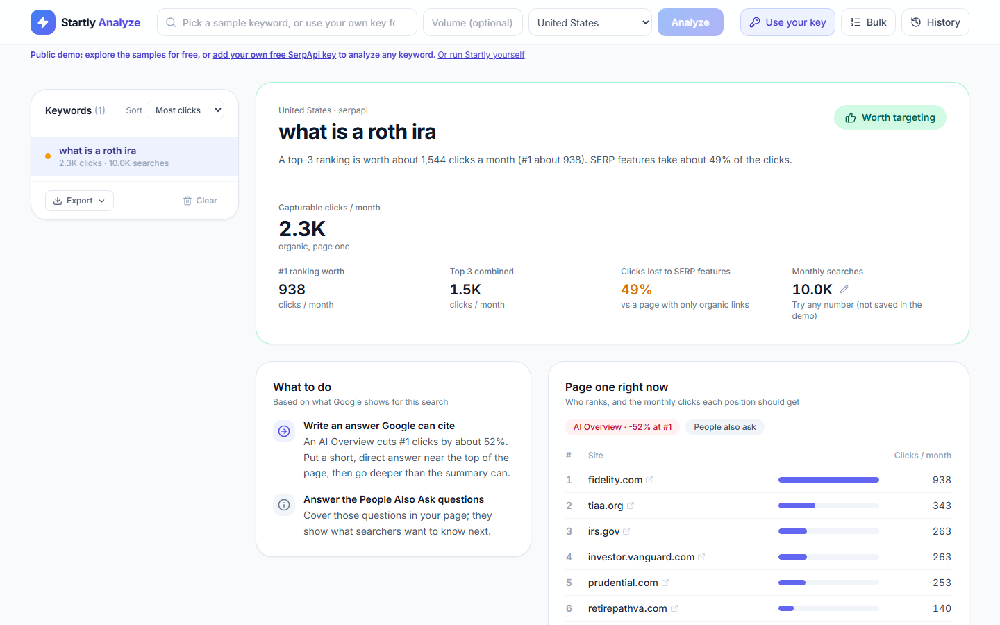
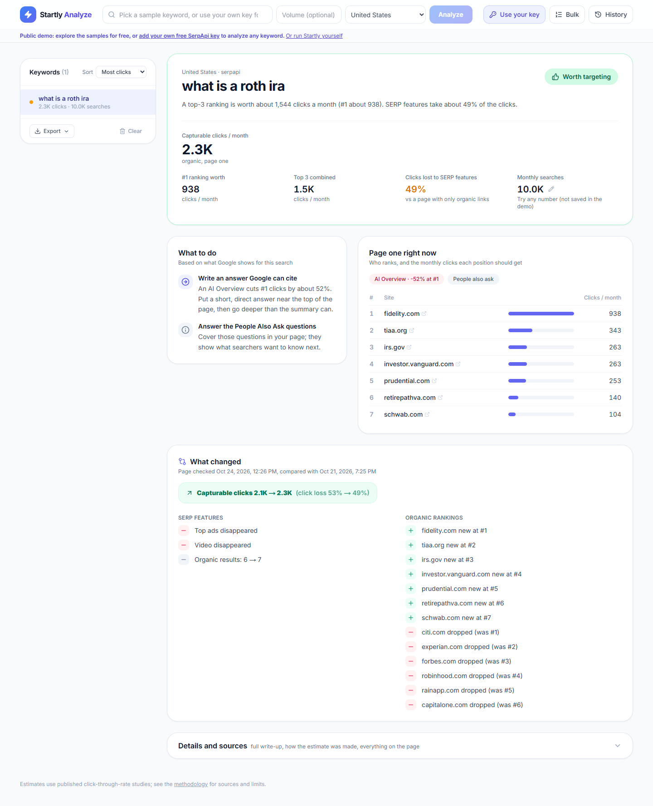

# Startly Analyze

**How many clicks can a keyword really bring, after Google's AI Overviews, ads and maps take their share?**

**[▶ Try the live demo](https://startly-analyze.onrender.com)**: free, no sign-up. It runs on a free hosting tier, so the first visit after a quiet period can take about a minute to wake up.

Search tools usually show how many people *search* for a keyword. Startly estimates how many of them would actually *click* an organic result. It reads the live Google results page for the keyword, sees what's on it (AI Overview, ads, map, images, People Also Ask…), and applies published click-through research to turn search volume into **capturable organic clicks**, with a range and a value for each ranking position.



## Why it exists

Google answers more and more searches on the results page itself, so "10,000 searches a month" can mean 8,000 clicks for websites or 800. The professional tools that show this cost $100 or more a month. Startly is a free, open alternative for bloggers, small businesses and anyone deciding what to write about, and it shows its sources and its uncertainty instead of a single confident number.

## What it does

- **A verdict for each keyword**: worth targeting, modest or low potential, from what the top positions are worth.
- **Capturable clicks with a range**, plus what ranking #1, #2, #3… is worth.
- **What takes the clicks**: AI Overviews, maps, images and ads, each with the size of its effect, its confidence and its source.
- **What to do next**, based on what Google shows for the search (for example, "write an answer Google can cite" when there's an AI Overview).
- **Who ranks now**: the sites on page one and the clicks each position should get.
- **Change tracking**: re-check a keyword and see what changed since last time (features, rankings and the effect on clicks).
- **Bulk analysis**: up to 50 keywords at once, with a cost preview before any paid search runs.
- **Exports**: a PDF report written as a document (summary, charts, a page per keyword, method and sources), and CSVs that open cleanly in Excel.
- **18 countries**, saved history, and search volume you can type in or edit at any time without an API call.

<details>
<summary>The full page: rankings and what changed since the last check</summary>



</details>

## How accurate is it?

Partly real data and partly estimates, and the app says which is which:

| Layer | Where it comes from | How much to trust it |
|---|---|---|
| The results page | The live Google page, fetched through SerpApi | Real, but a snapshot of one moment, one country and one device type |
| Monthly searches | Typed in by you (for example, from Google Keyword Planner) | Only as good as the number entered |
| Capturable clicks | Published click-through studies (Advanced Web Ranking 2026, Ahrefs) | Averages across millions of searches; a single keyword can differ by 2× |

It's most reliable for **comparing keywords** and **spotting traps** ("50,000 searches, but an AI Overview and a map take most of the clicks"), and least reliable as an exact forecast. The estimates haven't yet been checked against a real site's Search Console data. Every number, its source and the limitations are in **[METHODOLOGY.md](METHODOLOGY.md)**.

## Try it

### With Docker (the public demo, no keys needed)

```bash
docker compose up --build
```

Open [http://localhost:3000](http://localhost:3000). This runs the read-only demo with the sample keywords. To analyze your own keywords in it, click **Use your key** and add a free [SerpApi](https://serpapi.com) key (250 searches a month).

### For development (your own keys, everything saved)

**Backend** (Python 3.10 or newer):

```bash
cd backend
python -m venv .venv
.venv\Scripts\activate        # Windows; on macOS/Linux: source .venv/bin/activate
pip install -r requirements.txt
cp .env.example .env          # then add a key, see below
uvicorn main:app --reload --port 8000
```

**Frontend** (Node.js 20.9 or newer; an LTS release such as 22 or 24 is best):

```bash
cd frontend
npm install
npm run dev
```

Open [http://localhost:3000](http://localhost:3000).

Pick a data source in `backend/.env`:

| `SERP_PROVIDER` | Key | Notes |
|---|---|---|
| `serpapi` | `SERPAPI_API_KEY` from [serpapi.com](https://serpapi.com) | **Recommended.** Free tier of 250 searches a month, and the only free option here that detects AI Overviews |
| `serper` (default) | `SERPER_API_KEY` from [serper.dev](https://serper.dev) | Cheaper, but can't see AI Overviews, so click estimates run high when one is present |
| `dataforseo` | `DATAFORSEO_EMAIL`, `DATAFORSEO_PASSWORD` | Paid; can also supply search volume (`VOLUME_PROVIDER=dataforseo`) |
| `mock` | none | Fake data for development |

The **Data source** switch in the app's header changes the source per browser without a restart, and shows the credits left on each key. Results are cached in a local SQLite database (`backend/data/startly.db`, not committed) and fetched again after `CACHE_TTL_DAYS` (default 7). `MAX_API_CALLS_PER_DAY` (default 50) stops a bug from draining your credits.

**Tests** (offline, no keys needed):

```bash
cd backend
pip install -r requirements-dev.txt
pytest
```

```bash
cd frontend
npm run lint
```

## Running it publicly

Never deploy with your own API key and `DEMO_MODE=false`: anyone could spend your credits. The public version runs in **demo mode**:

- **Read-only.** It serves the sample keywords and never writes to the database or uses the server's keys.
- **Visitors bring their own key.** It stays in their browser and goes only with their own searches (in an `X-SerpApi-Key` header). The server uses it for that one request and never stores or logs it. Their results are saved in their browser too.
- **Sample data ships with the code** (`backend/demo_data/seed.json`). A demo server that starts with an empty database loads it automatically, so hosts with temporary disks work out of the box. To change the samples, analyze keywords locally, run `python demo_seed.py export` in `backend/`, and commit the seed.

Backend settings for a public deployment:

| Variable | Value | What it does |
|---|---|---|
| `DEMO_MODE` | `true` | Read-only demo |
| `ALLOWED_ORIGINS` | `https://your-frontend.example.com` | Only your site's pages may call the API (exact origin, including `https://`) |
| `RATE_LIMIT_PER_MINUTE` | `30` | Requests per visitor per minute; `429` with `Retry-After` beyond that |
| `TRUST_PROXY_HEADERS` | `true` | Behind a host's proxy: read the visitor's IP and `https` from forwarded headers |
| `TRUSTED_PROXY_HOPS` | `3` on Render; `1` behind a single proxy | How many proxies of your host add to `X-Forwarded-For`. On Render, a request passes Cloudflare, Render's load balancer and an internal proxy, so the visitor is 3rd from the right (measured October 2026; recheck if rate limiting stops working) |
| `SERPAPI_API_KEY` | *(leave empty)* | The demo doesn't need a server key |

The frontend needs one value **at build time**, because Next.js bakes it into the JavaScript: `NEXT_PUBLIC_API_BASE_URL=https://your-backend.example.com` (a Docker build argument).

Other protections: a Content Security Policy with a per-request nonce (`frontend/proxy.ts`) so the page can only run its own scripts and only talk to the API; keys refused over plain HTTP except on localhost; HSTS; `Cache-Control: no-store`; both containers run as non-root users.

## Design decisions

- **Free data sources first.** The project started on DataForSEO; when the paid credits ran out, it was redesigned around a provider interface, so SerpApi, Serper, DataForSEO and mock data are interchangeable.
- **A range, not a single number.** When several features overlap, their combined effect isn't well studied, so Startly shows both the stacked and the strongest-only result.
- **Bring your own key** instead of a shared server key: the demo costs nothing to run, and visitors' searches stay private.
- **SQLite.** One file, no database server. It fits a single-user tool and a read-only demo.
- **One server process.** The rate limiter lives in memory, which is correct for a single process. Running several would need shared storage such as Redis; one process handles the expected load.

## Known limits

- The click model uses industry averages and hasn't been validated against real traffic yet.
- Results pages are snapshots; the demo's samples are from October 2026.
- Search volume has to be entered by hand unless DataForSEO is configured.
- The live demo runs on Render's free tier: it sleeps after 15 minutes without visitors and takes about a minute to wake up.

## Project docs

- **[METHODOLOGY.md](METHODOLOGY.md)**: the click model, every number and its source, a worked example, limitations.
- **[ARCHITECTURE.md](ARCHITECTURE.md)**: components, data flow, storage, security, containers.

**Built with** Next.js 16, React 19, TypeScript and Tailwind CSS (frontend); FastAPI, SQLite and ReportLab (backend); Docker.
